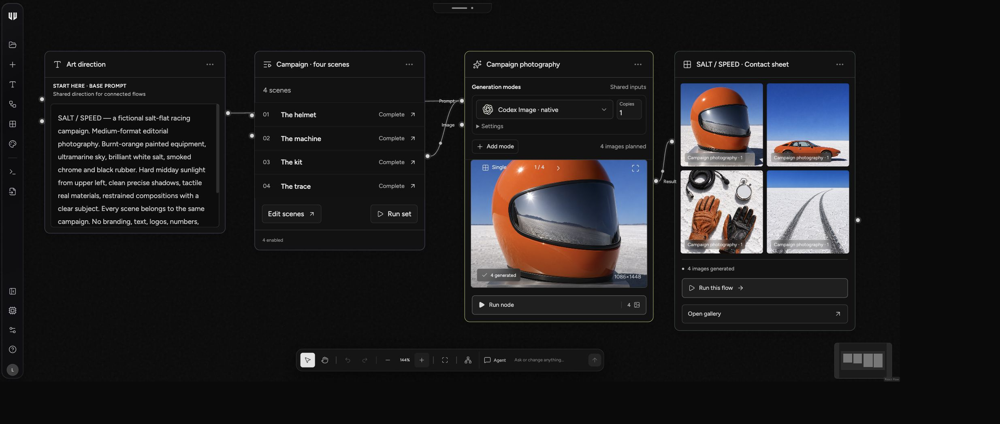
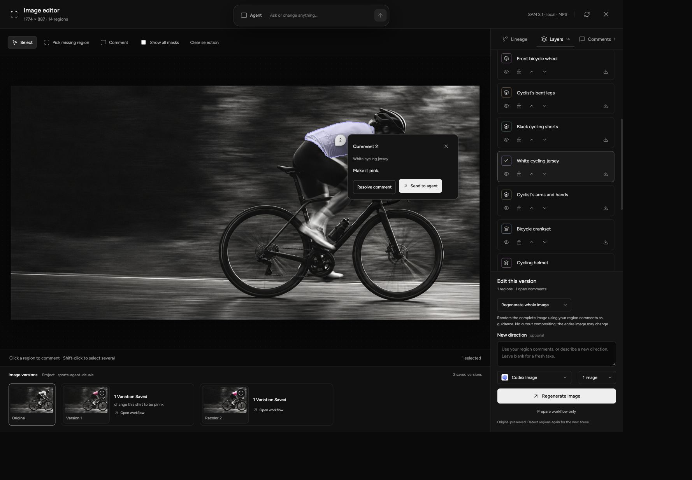
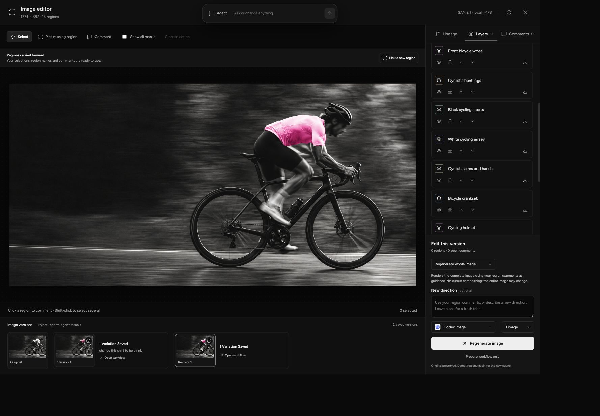

# Flow

**Agents: [read SETUP.md first](SETUP.md).**

A local canvas for image, GIF and video workflows. Connect reference images, shared prompts and scene collections, then run parallel batches through your own CLI harnesses, API providers or local models. Outputs keep their resolved prompts, settings, inputs and lineage.



One shared direction, four scenes, one campaign. [See the workflow with its original helmet seed.](docs/images/helmet-seed-workflow.jpg)

| Comment on a selected region                                                                                           | Keep editing the result                                                                                             |
| ---------------------------------------------------------------------------------------------------------------------- | ------------------------------------------------------------------------------------------------------------------- |
|  |  |

Select a region, leave an inline comment, and choose an edit. This example uses local recoloring to keep the scene intact and carry regions into the new version. AI edits can regenerate the whole image.

Flow runs on your computer. Each clone starts with its own local database and connects to its owner's providers. No hosted Flow account is required. macOS and Linux are verified in CI; Windows is not yet verified.

## Run locally

Use Node.js 22.13 or newer and npm on macOS or Linux. Follow [SETUP.md](SETUP.md) to clone, install, verify, and create the local demo. The guide includes a complete agent sequence for discovery, saved workflows, planning, runs, and output lineage.

Setup installs the `flow` command and managed agent skills. The demo produces four real images through Local color lab without accounts, model downloads, or paid inference. Reopening it preserves edits and reuses its run. For command locations, PATH, SDK imports, and removal, see [CLI and SDK installation](docs/installation.md).

Open **http://localhost:4310** for the normal workspace. `npm run serve` starts the background server. Stop it with `node cli/flow.mjs stop`; use `npm run dev` for foreground development. Connect your selected AI provider in **Settings → Providers** when needed. Local models, SAM, and semantic search have explicit optional downloads.

## Work on the canvas

- Add reference images and write the shared direction once.
- Use a Prompt Set for named scenes with per-scene copy, seed and aspect-ratio overrides.
- Select a provider and model on each generation branch, or compare several modes using the same inputs.
- Plan a batch before running it. Concurrency limits the queue; provider rate limits and hardware still apply.
- Open any image to inspect its complete saved inputs and lineage.
- Select image regions with SAM, attach inline comments, and send the request to an agent. AI edits regenerate the whole image using annotations as guidance. Local recoloring uses the selected mask and retains regions across versions.

The page-aware agent can propose workflow edits. Applying a proposal does not start image generation. Projects associate workflows and assets with a consuming local folder. Workflow edits, jobs, conversations and asset annotations persist across refreshes.

## Providers

Flow has separate adapters for Codex, Claude Code, Gemini CLI, Pi, OpenAI-compatible APIs, Google video APIs, Grok, fal, Ollama and ComfyUI. Available media, models and thinking controls depend on the adapter and account. The app checks prerequisites before submitting a run.

CLI harnesses use installed commands and their supported authentication. Compatible APIs use your configured base URL, model and API key. Flow does not route every provider through Pi. A consumer subscription does not automatically authorize a separately billed image or video API. See [provider setup](docs/PROVIDERS.md), [local models](docs/local-models.md) and [fal and Seedance](docs/fal-and-seedance.md).

Codex image access depends on the installed CLI and account. Its numeric seeds are variation labels, not deterministic model RNG seeds. Requested sizes can differ from returned dimensions. Failed jobs stay visible and never fall back to another provider without your choice.

The style catalog includes reusable style and scene prompts. Generated thumbnails, custom references and favorites belong to each local workspace; a fresh clone does not include the development machine's image library. See [styles](docs/styles.md).

## Use Flow from an agent

Point your agent at this checkout and give it this instruction:

> Read SETUP.md first, then AGENTS.md. Set up and verify Flow, create and plan a saved workflow for my project, and inspect provider readiness before running. Keep the returned run ID and report the viewer URL and output lineage.

[SETUP.md](SETUP.md) contains the command sequence. [AGENTS.md](AGENTS.md) covers repository contracts and source navigation. Use [agent workflows](docs/agents.md) for project context and graph edits, [managed skills](docs/agent-skills.md) for installed agent helpers, and [MCP setup](docs/mcp.md) for host configuration. The CLI, SDK, MCP, and canvas use the same local platform services.

## JavaScript SDK

From a consuming Node.js project, install your local checkout:

```sh
npm install --save /absolute/path/to/flow
```

```js
import { FlowClient } from "flow";
import { builtInStyles } from "flow/styles";

const flow = new FlowClient({ url: "http://localhost:4310" });
const projects = await flow.projects();
console.log(projects, builtInStyles.length);
```

Start the local server with `flow serve` first. The SDK includes graph builders, Flow file import/export, planning, run controls, uploads and lineage. It calls the same local services as the CLI and UI; importing it never starts inference. No npm registry publication is required. See [installation](docs/installation.md) and [agent examples](docs/agents.md).

## Save and exchange workflows

The file format is **Flow**, with the extension **`.flow.json`**. Both the canvas and CLI export a versioned JSON file with `format: "flow"`, `version: 1` and a `workflow` graph.

```sh
node cli/flow.mjs export WORKFLOW_ID --project my-app --output campaign.flow.json
node cli/flow.mjs import --from campaign.flow.json --project my-app --json
```

Files preserve prompts, references, settings and graph structure. They do not bundle image bytes or provider keys. Earlier plain graph JSON is still importable. See [Flow files and migrations](docs/flow-files.md) for the schema and transfer rules.

## Data and security

The server binds to `127.0.0.1`. It is intended for a trusted local account and has no multi-user authentication. Do not expose it publicly. Cloud providers receive submitted prompts and reference images; local runtime adapters do not automatically fall back to cloud inference.

`.flow/` holds the database, uploads, generated assets, provider connections and logs. It is excluded from Git. Use the public client or API for changes, rather than editing the database or JSON mirrors. Back up the complete data directory while the server is stopped.

Set `FLOW_DATA_DIR` to move storage, `PORT` to change the server port, and `FLOW_URL` to point clients at a different local address. Custom data directories need the same credential protection and Git exclusions. Read [SECURITY.md](SECURITY.md) before changing the server's exposure or execution model.

## Develop

```sh
npm ci
npm run check
npm run check:release
npm run check:licenses
```

`check` validates architecture, builds browser assets, then runs behavior tests. CI also scans the complete Git history with a pinned, checksum-verified Gitleaks binary. Tests use local fixtures and fake provider transports; they do not prove live account access. See [CONTRIBUTING.md](CONTRIBUTING.md) and [the architecture map](docs/ARCHITECTURE.md).

## License

Flow source and style briefs are MIT licensed: use, modify, redistribute, sublicense or sell them, including commercially, while retaining the license and copyright notice. There is no Flow license fee. Fonts, provider marks, dependencies and downloaded models retain their own terms; paid provider usage is separate. See [LICENSE](LICENSE) and [third-party notices](THIRD_PARTY_NOTICES.md). The npm package remains private. [The release explainer](docs/launch/index.html) includes product captures, the complete style catalog and the remaining asset/history release gates.
